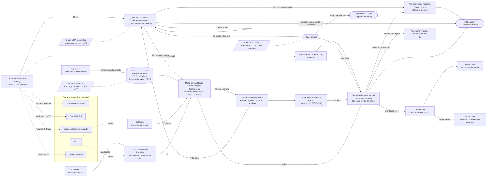

# C — Mapa de atores: Atendimento ao Seguro-Desemprego pela URA da Caixa

> **Serviço:** Seguro-Desemprego, trabalhador formal (Lei 7.998/1990; Res. CODEFAT 957/2022).
> **Canal:** URA/telefone **0800 726 0207** (Atendimento CAIXA Cidadão).
> **Órgãos:** Caixa Econômica Federal (agente pagador e dona do canal) e Ministério do Trabalho e Emprego (concedente).
> **Retrato:** novembro de 2026 (D2).
> **Origem:** decisões D1–D28 de `C_grill_transcript.md`, sobre a pesquisa `B_relatorio_assistente_v3.md`.
> **Formato:** diagrama mermaid e tabela RACI (D4).

**Legenda dos marcos da jornada (D26):**
- **t0:** ligação
- **t1:** menu e identificação
- **t2:** consulta
- **t3:** transbordo para atendente ou para outro canal
- **t4:** encerramento, que pode ser resposta, encaminhamento ou desistência

## 1. Diagrama de fluxo e relações

## 2. Tabela RACI de atores

R = Responsável (executa) · A = Aprovador (responde) · C = Consultado · I = Informado.

| # | Ator | Tipo | Categoria | Responsável (R) | Aprovador (A) | Consultado (C) | Informado (I) | Entra | Sai | Decisão |
|---|---|---|---|---|---|---|---|---|---|---|
| 1 | Cidadão (trabalhador formal) | Humano | Demandante | Iniciar a ligação, identificar-se (NIS) | — | — | Status da parcela; canal de destino | t0 | t4 (resposta, encaminhamento ou desistência) | D1, D3, D16 |
| 2 | URA 0800 726 0207 | Sistema automatizado (DTMF; IA não confirmada) | Linha de frente | Autoatendimento de pagamento; transbordo | — | Motor de habilitação | — | t0 | t3/t4 | D5, D14 |
| 3 | Atendente humano do call center (terceirizado) | Humano | Linha de frente | Atender o transbordo; encaminhar dúvida de concessão | — | Motor de habilitação | — | t3 | t4 | D9, D13 |
| 4 | Intérprete de Libras (ICOM) | Humano | Linha de frente | Intermediar o atendimento acessível | — | — | — | t3 (sob demanda) | t4 | D12 |
| 5 | Gestor/fiscal do contrato (Caixa) [INFERÊNCIA] | Humano | Normatizador/gestor | Fiscalizar níveis de serviço do teleatendimento | — | — | Indicadores do call center | Fora da ligação | — | D10, D27 |
| 6 | Caixa Econômica Federal | Institucional | Normatizador/gestor | Pagar a parcela | **A** do canal e da dúvida de pagamento | MTE | Liberação da parcela | t2 (dado de pagamento) | t4 | D9, D14 |
| 7 | Assistente virtual do WhatsApp Caixa | IA | Canal de destino | Responder dúvidas de pagamento por chat | — | — | — | t3 | t4 | D6 |
| 8 | Celeste (MTE) | IA | Canal de destino | Orientar sobre o serviço do MTE | — | — | — | t3 (via 158/portal) | t4 | D6 |
| 9 | Central 158 | Institucional (URA + atendentes do MTE) | Canal de destino | Orientar e agendar atendimento presencial | — | — | — | t3 | t4 | D20 |
| 10 | App Carteira de Trabalho Digital / gov.br | Sistema automatizado | Canal de destino | Consulta de concessão, recurso, notificação | — | — | — | t3 | t4 | D21 |
| 11 | SRTE / Sine | Humano | Canal de destino | Requerimento e recurso presenciais | — | — | — | t3 (agendado) | t4 | D22 |
| 12 | MTE / Secretaria de Trabalho | Institucional | Normatizador/gestor | Conceder; julgar recurso | **A** da dúvida de concessão e do motor | CODEFAT | Falhas apontadas pelo TCU | Retaguarda | — | D13, D15, D20 |
| 13 | Motor de habilitação (Sistema Seguro-Desemprego) | Sistema automatizado | Retaguarda | Decidir automaticamente o direito (art. 4º, Res. 957) | — | Bases de vínculo | URA e atendente (via consulta) | Antes de t0 | — | D7, D15 |
| 14 | Dataprev | Institucional | Retaguarda | Operar o motor e o portal (R técnico) | — | — | — | Retaguarda | — | D15 |
| 15 | Bases de vínculo (CNIS, eSocial, Empregador Web, FGTS) | Sistema automatizado | Retaguarda | Fornecer dados de vínculo | — | — | Motor de habilitação | Antes de t0 | — | D8, D27 |
| 16 | Empregador | Humano | Retaguarda (fonte) | Transmitir o desligamento | — | — | Bases de vínculo | Antes de t0 | — | D11, D27 |
| 17 | CODEFAT | Institucional | Normatizador/gestor | Editar resoluções (Res. 957/2022) | — | **C** do MTE | — | Fora da ligação | — | D15 |
| 18 | SAC/Ouvidoria Caixa | Institucional | Controle e defesa | Responder reclamação sobre o canal | — | — | **I** | Após t4 | — | D18 |
| 19 | TCU | Institucional | Controle e defesa | Auditar (Ac. 135/2024, 1114/2025, 1621/2026) | — | — | **I** | Fora da ligação | — | D17 |
| 20 | CGU/Fala.BR | Institucional | Controle e defesa | Receber manifestação sobre o MTE | — | — | **I** | Após t4 | — | D17 |
| 21 | Senacon/consumidor.gov.br | Institucional | Controle e defesa | Mediar reclamação contra a Caixa | — | — | **I** | Após t4 | — | D17 |
| 22 | Justiça Federal | Institucional | Controle e defesa | Decidir ação sobre o benefício | — | — | **I** | Após t4 | — | D17 |

**Resumo da tipologia (D24):** 22 atores.
- 6 humanos: 1, 3, 4, 5, 11 e 16 (o atendimento humano do 158 está embutido no ator 9).
- 2 de IA: 7 e 8.
- 4 sistemas automatizados: 2, 10, 13 e 15.
- 10 institucionais: 6, 9, 12, 14, 17, 18, 19, 20, 21 e 22.

## 3. Decisões do `/grill-me` refletidas no mapa

- **D1:** só o trabalhador formal. Doméstico (LC 150), pescador artesanal (Lei 10.779, gestão do MTE desde 1º/11/2025) e resgatado ficam fora do RACI.
- **D5:** a URA não é rotulada como IA. Não há prova de reconhecimento de voz, que é a lição da falha F21 da auditoria v1 do Grok.
- **D7 e D15:** o ator invisível central é o **motor de habilitação**. Ele decide, a Dataprev executa, o MTE responde e o CODEFAT normatiza.
- **D9 e D10:** a terceirização do atendimento fica explícita. O nome do fornecedor da CECOT 121/2026 está **[NÃO CONFIRMADO]**.
- **D13 e D14:** o RACI é dividido.
  - Na dúvida de **concessão**, o A é o MTE.
  - Na dúvida de **pagamento**, o A é a Caixa.
- **D16:** a **desistência** aparece como saída sem responsável. Esse é o principal achado crítico do mapa.
- **D19:** ANPD e Justiça do Trabalho ficaram fora porque só aparecem como inferência na v3.

## 4. Limitações

- Não estão confirmados em fonte primária:
  - o menu atual da URA;
  - a tecnologia de voz da URA;
  - o vencedor da CECOT 121/2026;
  - o operador do 158.
- O ator 5 (Gestor/fiscal do contrato) é **[INFERÊNCIA]**, a partir da Lei 13.303/2016.
- **Método:** as decisões D17 a D28 foram tomadas por **delegação expressa do entrevistado ao agente**, a partir da Rodada 4. O registro está em `C_grill_transcript.md`.
